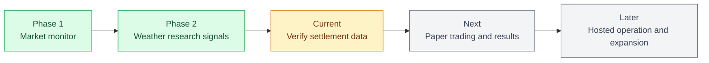

# PolyEdge project status

**Updated:** 2026-10-26
**Current stage:** Phase 2 research signals are built. The project is ready for settlement-data verification and a paper-trading evaluation.

## Where we are on the map

## Completed

### Phase 1: weather-market monitor

- Public Polymarket weather-market discovery and contract normalization.
- Public YES/NO order-book snapshots with retries, validation, and per-market error recording.
- Local JSON storage with an optional Supabase schema for market data.
- Next.js dashboard for the market list, scan health, individual markets, analytics, settings, and refresh controls.
- A local single-process watcher that refreshes markets every 30 minutes and prices every 5 minutes.

### Phase 2: local weather research

- GFS ensemble forecasts at named NOAA airport coordinates and hourly airport-observation collection.
- Historical 24-hour-ahead forecast backfill and rolling validation based on 28 complete days.
- Conservative YES/NO research decisions that account for forecast uncertainty, book liquidity, ask price, and weather fees.
- A dashboard page that explains each decision in plain English.
- A public-weather-trader research watchlist that can be used for paper evaluation.

## Current position

The application can monitor weather markets and produce local, explainable research calls. The model is deliberately conservative, and it makes no trades or wallet connections.

The central remaining uncertainty is the settlement source. Forecast errors are currently compared with airport METAR daily maxima, while contracts reference weather.gov data. The exact settlement series, cutoff times, fallback rules, and corrections have not been verified. That means the current signals are useful research inputs, not validated trading predictions.

## To do

| Priority | Task | Done when |
| --- | --- | --- |
| Now | Verify each supported contract's weather.gov settlement source, time window, and fallback rules. | The data used for model evaluation matches each contract's settlement rule. |
| Now | Record the exact official settled result for monitored contracts. | A resolved-outcome dataset exists for every evaluated signal. |
| Next | Add paper trading with the default $250 bankroll. | Each eligible signal records available price, liquidity, fee, simulated fill, and outcome. |
| Next | Evaluate performance after enough settled markets. | Calibration, simulated P&L, drawdown, and fill assumptions are reported. |
| Later | Decide whether to move Phase 2 collectors and signals to Supabase. | The hosted storage design supports forecasts, observations, history, and signals. |
| Later | Add alerts and broaden weather-market coverage. | New categories meet the same data-quality and settlement-verification standard. |

## Working rhythm

Run the local watcher during active research. It refreshes markets, prices, forecasts, observations, signals, and trader research on its configured cadence. Before treating any signal as an evaluation candidate, complete the settlement-rule check and capture the first available price and liquidity at the time of the signal.

## Useful references

- [How it works](../README.md#how-it-works)
- [Architecture](architecture.md)
- [Roadmap](roadmap.md)
- [API integration notes](api-integrations.md)
- [Weather trader research watchlist](trader-watchlist.md)
